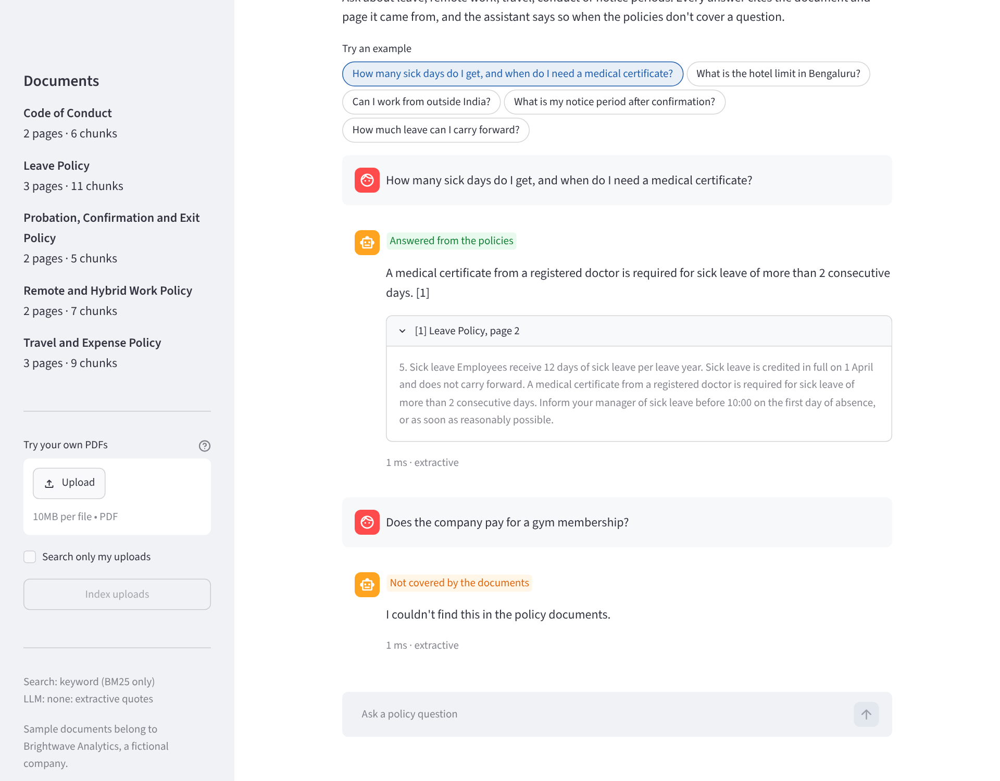
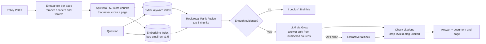

# HR Policy Assistant

Employees ask questions about company policies in plain English. The assistant answers from the policy PDFs, cites the exact document and page, and says "I couldn't find this" instead of guessing.

**Live demo:** _add your Hugging Face Spaces link here_ · **Video walkthrough:** _add link_



## The problem

HR teams answer the same questions every week: how much leave carries over, what the hotel limit is, how long the notice period is. The answers are in policy PDFs that few people read. A general chatbot isn't safe here, because it will confidently invent a policy that doesn't exist. This assistant only answers from the company's own documents, and shows its sources so anyone can check.

## What it does

- **Cited answers:** every answer links to the document and page it came from, with the source text one click away.
- **Says when it doesn't know:** an evidence check stops off-topic questions before they reach the LLM, and the LLM is told to refuse when the sources don't answer the question.
- **Hybrid search:** keyword search (BM25) finds exact terms like "L5" or "INR 1,500"; semantic search (embeddings) finds "vacation days" when the policy says "annual leave".
- **Checks the LLM's work:** citations to sources that don't exist are removed, and answers with no citation are flagged as unverified.
- **Keeps working when the LLM fails:** if the API is down or no key is set, it falls back to quoting the most relevant sentences.
- **Your own PDFs:** upload policies in the web app (private to your session) or through the API.
- **Measured:** a set of 40 test questions scores retrieval and answers. See [Results](#results).

## How it works



## Results

Measured with `eval/run_eval.py` on 34 answerable questions (each with a known source page) and 6 questions the policies don't answer. The questions are worded differently from the policies, the way employees actually ask.

| Configuration | Hit@1 | Hit@3 | MRR | Fact accuracy | Citation accuracy | Correct refusals |
| --- | --- | --- | --- | --- | --- | --- |
| Keyword search + extractive fallback (no API key) | 0.91 | 0.91 | 0.92 | 0.62 | 0.71 | 1.00 |
| Hybrid search + Groq LLM | _run it_ | | | | | |

**How to read this:** Hit@1 is how often the page holding the answer is the top search result. MRR rewards finding it near the top. Fact accuracy checks the answer contains the right number or rule, and citation accuracy checks it cites the right page. Correct refusals is the share of off-topic questions answered with "I couldn't find this".

**Experiments that shaped the defaults** (keyword search):

| Chunk size | Hit@1 | Hit@3 | MRR |
| --- | --- | --- | --- |
| 60 words (chosen) | 0.91 | 0.91 | 0.92 |
| 120 words | 0.82 | 0.94 | 0.88 |
| 200 words | 0.82 | 0.94 | 0.88 |

| Evidence-gate threshold | Answerable questions wrongly refused | Off-topic questions stopped |
| --- | --- | --- |
| 0.20 | 0% | 50% |
| 0.25 (chosen) | 3% | 50% |
| 0.35 | 12% | 67% |
| 0.40 | 24% | 100% |

Smaller chunks rank the exact page first more often. For the gate, wrongly refusing a real question costs more than letting an off-topic one through, because the LLM is a second check that can still refuse. So 0.25 was chosen.

**Known misses:** keyword search can't connect "new fathers" to "paternity leave". That is the case semantic search is there for. Run the eval with hybrid search to measure the difference.

## Run it locally

You need Python 3.10 or later.

```bash
git clone https://github.com/<your-username>/hr-policy-assistant.git
cd hr-policy-assistant
python -m venv .venv
source .venv/bin/activate          # Windows: .venv\Scripts\activate
pip install -e ".[dev]"

cp .env.example .env               # then paste your Groq key into .env
streamlit run app.py               # opens http://localhost:8501
```

Get a free Groq API key at [console.groq.com/keys](https://console.groq.com/keys). Without a key the app still runs, but answers are quoted sentences instead of generated text.

The first run downloads the embedding model (about 70 MB), which needs internet access.

### The API

```bash
uvicorn policy_assistant.api:app --reload
```

Interactive docs are at http://localhost:8000/docs. Main endpoints:

| Method | Path | Purpose |
| --- | --- | --- |
| `POST` | `/ask` | `{"question": "..."}` returns the answer, citations, status, latency and token use |
| `GET` | `/documents` | Lists indexed documents |
| `POST` | `/documents` | Uploads a PDF (needs the `X-Admin-Token` header when `ADMIN_TOKEN` is set) |
| `GET` | `/health` | Shows search mode, LLM and document count |

### Tests and evaluation

```bash
pytest                                     # 31 tests, run offline, no API key needed
python eval/run_eval.py                    # retrieval scores with hybrid search
python eval/run_eval.py --answers          # also scores full answers (uses the LLM if a key is set)
python eval/run_eval.py --sweep-gate       # compare evidence-gate thresholds
python eval/run_eval.py --no-dense --chunk-words 120   # try other settings
```

## Deploy to Hugging Face Spaces (free)

1. Create a new Space at [huggingface.co/new-space](https://huggingface.co/new-space), and choose **Docker** as the SDK.
2. In the Space's **Settings → Variables and secrets**, add a secret named `GROQ_API_KEY`.
3. Push this repository to the Space:
   ```bash
   git remote add space https://huggingface.co/spaces/<your-username>/hr-policy-assistant
   git push space main
   ```
4. The Space builds the Dockerfile and serves the app on port 7860. The settings block at the top of this README tells Spaces how to run it.

## Configuration

All settings come from environment variables. See `.env.example`.

| Variable | Default | Meaning |
| --- | --- | --- |
| `GROQ_API_KEY` or `LLM_API_KEY` | none | API key. Without it, answers are extractive quotes. |
| `LLM_BASE_URL` | Groq's endpoint | Any OpenAI-compatible endpoint: OpenAI, Together, OpenRouter, local Ollama |
| `LLM_MODEL` | `llama-3.3-70b-versatile` | Check the current model list in your provider's console |
| `USE_DENSE` | `true` | `false` turns off semantic search |
| `TOP_K` | `5` | Chunks sent to the LLM |
| `MIN_KEYWORD_COVERAGE` | `0.25` | Evidence-gate threshold for keyword overlap |
| `MIN_DENSE_SIMILARITY` | `0.62` | Evidence-gate threshold for semantic similarity. Tune it with `--sweep-gate` |
| `ADMIN_TOKEN` | none | Required for API uploads when set |

## Design decisions

- **No vector database.** A few hundred chunks fit in memory as a NumPy array, and searching them takes about a millisecond. Adding a database server would add cost and moving parts with no benefit at this size. For thousands of documents, the `HybridRetriever` class is the one place to swap in pgvector or Qdrant.
- **Chunks never cross a page,** so every citation points to exactly one page.
- **Rank fusion instead of score blending.** BM25 scores and cosine similarities are on different scales. Reciprocal Rank Fusion only uses each list's ranking, so nothing needs tuning.
- **Rare words count more in the evidence gate.** Matching "company" (which is in every policy) says little; matching "gym" says a lot. Weighting by IDF stopped questions like "Does the company pay for a gym membership?" from slipping through.
- **OpenAI-compatible client.** Changing provider is a configuration change, not a code change.
- **Uploads in the web app stay in the visitor's session,** so one visitor can't change what others see.

## Limitations and next steps

- Scanned PDFs need OCR first; the app reports when a PDF has no text.
- Tables are read as plain text, so complex tables can lose their structure.
- The test set is small (40 questions) and the thresholds were tuned on it, so scores on new documents will be lower. A separate held-out question set would give a fairer estimate.
- The semantic-similarity threshold (`0.62`) is a starting value; calibrate it with `--sweep-gate`.
- Next: score answer faithfulness with an LLM judge (Ragas) and run the evaluation in CI so a change that lowers quality fails the build.

## Project structure

```
app.py                      Streamlit web app
src/policy_assistant/
    config.py               Settings from environment variables
    ingest.py               PDF reading, header/footer removal, chunking
    retrieval.py            BM25 + embeddings, rank fusion, evidence gate
    llm.py                  Prompt, OpenAI-compatible client, citation checks
    pipeline.py             The full ask() flow and the extractive fallback
    api.py                  FastAPI endpoints
eval/                       Test questions, evaluation script, saved results
tests/                      pytest suite (runs offline)
data/policies/              Sample policy PDFs
data/source/                Markdown sources for the sample PDFs
scripts/build_sample_pdfs.py
```

## About the sample data

Brightwave Analytics is a fictional company. Its policies were written for this project and are loosely based on common practice in Indian companies. They are not legal or HR advice.

## License

MIT
